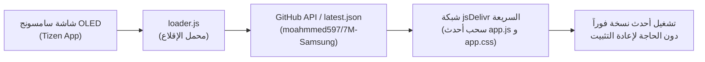

# 🎬 أرشيف مشروع: Stremio Samsung 7M

> **إصدار التلفزيون المستهدف:** Samsung OLED S90D (2024) — Tizen OS 8.0  
> **مستودع GitHub:** [`moahmmed597/7M-Samsung`](https://github.com/moahmmed597/7M-Samsung.git)  
> **الفرع الأساسي:** `main`  
> **المسار المحلي على جهازك:** `C:\Users\hamoo\Documents\kai-fork`  
> **مجلد النسخ الاحتياطي:** `C:\Users\hamoo\Documents\Stremio-Kai-Backup\2026-11-14`  

---

## ⚡ كيف يعمل التحديث التلقائي على شاشة التلفاز؟

يعمل تطبيق **Stremio 7M** على شاشتك بآلية تحديث ديناميكية متقدمة تماثل البث السحابي:



1. بمجرد فتح التطبيق على التلفزيون، يقوم ملف `loader.js` بطلب ملف `latest.json` من مستودعك على GitHub لمعرفة رقم الـ Commit الأخير (`sha`).
2. يسحب التلفزيون ملفات `app.js` و `app.css` الحديثة مباشرة من شبكة التوزيع السحابية (jsDelivr CDN) المشبوكة على مستودعك.
3. **النتيجة:** كل تعديل يتم عمل `git push` له مع تحديث `latest.json`، **يظهر على شاشتك فوراً عند تشغيل التطبيق** دون أي خطوات يدوية!

---

## 🛠️ سجل التعديلات والإضافات الكاملة (Features Log)

### 1. حل مشكلة الترجمة العربية و SubDL بالكامل
* **دعم صيغ ASS/SSA:** بناء محلل نصوص مدمج (`parseAss`) يقرأ أسطر `Dialogue:` ويستخرج التوقيتات الدقيقة مع تنظيف أكواد الستايل المعقدة.
* **إعادة التوجيه (HTTP Redirects):** تمكين السيرفر المحلي من تتبع روابط إعادة التوجيه حتى 5 مرات لسحب ملفات الترجمة المضغوطة ZIP من SubDL وفكها بسلاسة.
* **فك ترميز CP1256 / Windows-1256:** تحويل بايتات النصوص العربية القديمة تلقائياً إلى UTF-8 لحل مشكلة الرموز الغريبة.
* **محاذاة النص العربي RTL:** ضبط اتجاه الكتابة من اليمين لليسار مع إبقاء موقع الترجمة في منتصف الشاشة دائماً وضبط علامات الترقيم في نهايات الجمل.
* **مكتبة الخطوط العربية المدمجة:** إضافة خطوط: المراعي (Almarai)، تجوال (Tajawal)، المسيري (El Messiri)، سامسونج ون (SamsungOne Arabic)، والأميري/كايرو.
* **نمط التباين العالي لشاشات الـ OLED:** نمط `strongbox` بلون أسود داكن خلف النص يضمن قراءة واضحة جداً حتى في أسطع المشاهد عالية الديناميكية (HDR).

---

### 2. الملفات الشخصية والدخول التلقائي (Profiles)
* **شاشة "من يشاهد؟" (Choose Profile):** إتاحة فتح واجهة اختيار الحسابات حتى للمستخدمين ذوي البروفايل الواحد مع بطاقة `+` لإضافة حسابات جديدة.
* **خيار الدخول التلقائي:** إضافة مفتاح في الإعدادات: *"السؤال 'من يشاهد؟' عند التشغيل"* للتحكم فيما إذا كان التطبيق يدخل مباشرة أم يعرض شاشة الحسابات.
* **زر مباشر في الإعدادات:** *"اختيار الملف الشخصي الآن"* للانتقال السريع لتبديل الحساب.

---

### 3. حماية شاشة سامسونج OLED من التطبيع (Burn-in Prevention)
* **شاشة سوداء نقية 100% (`#000000`):** تنشط تلقائياً بعد 90 ثانية من إيقاف الفيديو مؤقتاً (Pause) أو ترك الجهاز بدون حركة، مما يطفئ بكسلات لوحة الـ OLED تماماً ويحمي الشاشة.
* **ساعة رقمية عائمة:** ساعة تتحرك بهدوء في زوايا عشوائية تمنع ثبات أي بكسل مشتعل.
* يمكن تفعيل أو تعطيل هذه الحماية بضغطة زر من قائمة الإعدادات.

---

### 4. إعادة ترتيب القوائم العلوية (Topbar Order)
أصبح الترتيب السلس للواجهة:
1. **الرئيسية (Home / Início)**
2. **الأنمي (Anime)**
3. **السلاسل والمجموعات (Collections)**
4. **البحث (Search)**
5. **المكتبة (Library)**
6. **التقويم (Calendar)**
7. **الإعدادات (Settings)**

---

### 5. صف "سلاسل قيد المتابعة" في الصفحة الرئيسية (Active Sagas Row)
* يظهر تلقائياً في الشاشة الرئيسية أسفل صف "أكمل المشاهدة" بمجرد البدء بمشاهدة أي عمل من أي سلسلة.
* يعرض بوستر العمل التالي غير المشاهد، مع نسبة إنجازك في السلسلة (مثلاً: `5/14`).
* **الضغط عليه ينقلك فوراً للسلسلة** ويكون زر `[▶ التالي: اسم العمل]` محدداً مسبقاً لبدء المشاهدة بنقرة ثانية.

---

### 6. نافذة العد التنازلي التفاعلية للحلقة التالية (Up Next Popup)
* نافذة مدمجة في مشغل الفيديو تظهر قبل نهاية الحلقة بـ 10 ثوانٍ مثل نتفليكس وديزني.
* عد تنازلي `يبدأ خلال {n}ث` مع زر `[▶ مشاهدة الآن]` وزر `[إلغاء]` (أو الضغط على زر Back بالريموت للبقاء في الحلقة).

---

### 7. التنظيم الشامل للسلاسل وعوالم مارفل ودي سي

#### أولاً: مارفل وإكس-مين (MCU & Multiverse)
* **قائمة الـ MCU الكبرى:** تضم جميع أفلام مارفل ستوديوز الرسمية + أفلام X-Men الـ 14 الواقعية + أفلام Spider-Man (توبي ماغواير وأندرو غارفيلد) بإجمالي 70 عملاً.
* **فلاتر سريعة ذكية في أعلى صفحة الـ MCU:**
  * `[الكل (70)]`: التايم لاين الشامل للملتيفيرس.
  * `[مارفل الرسمية (52)]`: عزل إنتاجات مارفل ستوديوز الأساسية.
  * `[X-Men (14)]`: عزل أفلام المتحولين الـ 14 داخل المارفل.
  * `[Spider-Man (8)]`: عزل جميع أفلام سبايدرمان.
* **قوائم مستقلة:**
  * قائمة مستقلة لأفلام **إكس-مين (X-Men)**.
  * قائمة مستقلة لأفلام **سبايدر مان (Spider-Man)**.
  * قائمة مستقلة لأفلام **فانتاستيك فور (Fantastic Four)**.
  * قائمة مستقلة لأفلام **بليد (Blade)**.
  * قائمة مستقلة لـ **عالم إكس-مين الكرتوني (X-Men Animated)** معزولة بالكامل تحت قسم الكرتون.

#### ثانياً: عالم دي سي (DC & Batman)
* **عالم دي سي الممتد (DCEU):** يضم 16 عملاً من أفلام العالم السينمائي الرسمي المترابط.
* **سلسلة أفلام باتمان السينمائية (Batman):** تضم أفلام باتمان الكلاسيكية وثلاثية نولان وفيلم 2022.
* **ثلاثية نولان (The Dark Knight Trilogy):** معزولة أيضاً كقائمة مستقلة لمن يريد الثلاثية فقط.
* **عالم DC الكرتوني (DCAU):** يضم مسلسلات كرتون باتمان وسوبرمان وجستس ليغ في قسم الكرتون.
* **أزرار ربط سريعة `[🔗]`:** تسمح بالانتقال اللحظي بين هذه السلاسل بلمسة زر واحدة.

---

### 8. الحفاظ التام على خفة التلفزيون والذاكرة (RAM Optimization)
* تقليل استهلاك ذاكرة شاشات سامسونج الحرة (~180MB) عبر إلزام جميع البوسترات بسحب نسخ `small/` أو `w185` فقط بحجم لا يتجاوز ~14KB للصورة (بدلاً من 40MB للصور الخام).
* اعتماد خادم `wsrv.nl` للصور العريضة لضغطها وتصغيرها سحابياً قبل وصولها للتلفاز.
* استخدام CSS Vector خالص لجميع الإضافات والأشرطة والمؤشرات لا يستهلك أي بايت إضافي في الذاكرة.

---

## 💻 أوامر سريعة للإدارة (Cheat Sheet)

عند الرغبة في تحديث أو بناء المشروع مستقبلاً من سطر الأوامر داخل مجلد المشروع:

```powershell
# بناء الحزمة البرمجية
npm run build

# بناء حزمة التثبيت لشاشة سامسونج (.wgt)
node tools/build-wgt.mjs

# ختم كود الإصدار للتحديث التلقائي
node tools/stamp-latest.mjs

# رفع التحديثات إلى GitHub
git add src dist out latest.json
git commit -m "Your update message"
git push fork main

# عمل نسخة احتياطية محلية متكاملة
git bundle create "C:\Users\hamoo\Documents\Stremio-Kai-Backup\2026-11-14\stremio-kai-all-history.bundle" --all
```
