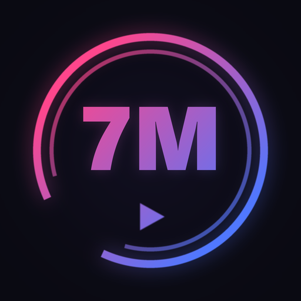
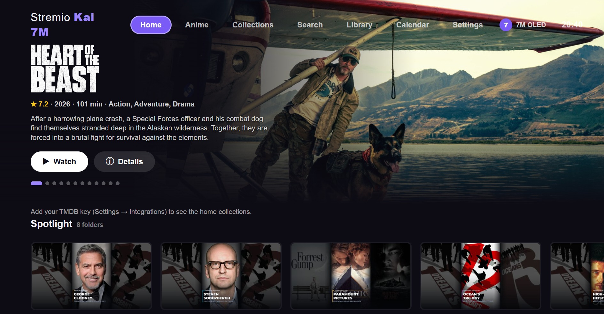
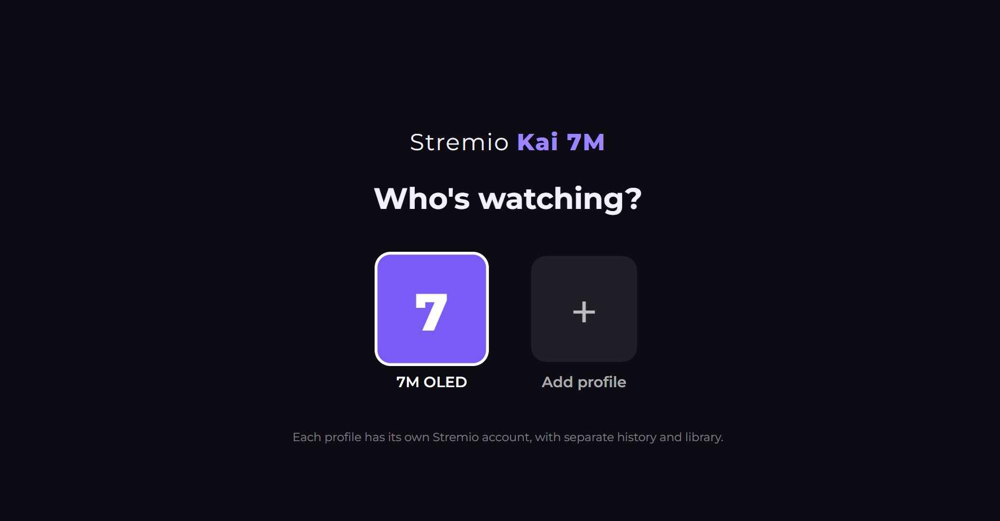

# Stremio Kai 7M for Samsung Tizen

<div align="center">
  
  <br/>
  <h3>The Modern Stremio Experience Crafted for Samsung Smart TVs (Tizen OS)</h3>
  <p>
    <b>Hardware AVPlay · Embedded MKV Subtitles · OLED Burn-in Protection · Franchise Timelines · UltraAnime · Multi-Profile</b>
  </p>

  [](https://github.com/moahmmed597/Stremio-Kai-7M/releases/latest)
  [](https://github.com/moahmmed597/Stremio-Kai-7M/releases/download/v1.2.1-7m/Stremio7M.wgt)
  [](https://www.samsung.com)
  [](https://github.com/moahmmed597/Stremio-Kai-7M)
  [](LICENSE)

  <br/><br/>
  <a href="https://github.com/moahmmed597/Stremio-Kai-7M/releases/latest">
    
  </a>
</div>

---

**Stremio Kai 7M** brings the modern, clean look and rich features of Stremio Kai to Samsung Tizen TVs, including older models (2017+ Tizen 3.0) and the newest 2024 OLED TVs (S90D/S95D on Tizen 8.0). It runs natively via [TizenBrew](https://github.com/reisxd/TizenBrew) or as a standalone `.wgt` app, completely controllable with your Samsung TV remote.

> **Open Source & Independent.** Licensed under GNU GPL-3.0. Not affiliated with Stremio, Stremio Kai, or Samsung. The app hosts no content: it only displays what the add-ons on **your** Stremio account provide.

<div align="center">
  
  
  <br/>
  <sub><i>Left: Built-in UltraAnime Hub with Seasonal Anime Artwork · Right: Native Arabic RTL Interface</i></sub>
</div>

---

## 📲 Get it on every device

One app, one codebase. Downloads are on the [Releases page](https://github.com/moahmmed597/Stremio-Kai-7M/releases/latest).

| Device | File | How to install |
| --- | --- | --- |
| **Samsung TV (Tizen)** | `Stremio7M.wgt` or TizenBrew | See "Installation Guide for Samsung Tizen TVs" below |
| **Android phone / tablet** | `Stremio-Kai-7M-android.apk` | Open the file, allow "install unknown apps" once |
| **Android TV / Google TV (TCL, Hisense, Sony, Xiaomi, Chromecast with Google TV…)** | `Stremio-Kai-7M-android.apk` | Put it on a USB stick, or install the **Downloader** app on the TV and type the release link, or `adb install`. It shows in the apps row and works with the TV remote |
| **iPhone / iPad** | `Stremio-Kai-7M-ios-unsigned.ipa` | Install **SideStore** or **AltStore** (they sign apps with your own Apple ID), open the `.ipa` in it. The TV address is not needed |
| **Windows** | `Stremio-Kai-7M-*-windows-portable.exe` | Download and run. F11 = full screen |

All builds are made by GitHub Actions from this repository (`.github/workflows/build-apps.yml`), so what you download is what is in the source.

> The iPhone and Android files are **not** from an app store and are **not** signed by a company. Android may show a warning once; the iPhone build is signed by your own SideStore/AltStore.

**Same features everywhere:** home, anime, manga (your own Suwayomi server), comics, books, live TV (your own M3U lists), calendar, library, multi-profile, 3 languages. On phones and PC the screen is scaled to fit and works with touch, mouse and keyboard. Samsung-only extras (hardware AVPlay, embedded audio track switching) stay on the Samsung build; other devices use the system player.

### What the app does not contain
No movies, no channels, no manga, no sources. Streams come from the Stremio add-ons of **your** account; manga from **your** Suwayomi server; live TV from **your** playlists.

---

## 🌟 What's New in 7M Edition?

The **7M Edition** introduces over **22,000+ lines of enhancements** across 69 files over the upstream base, heavily tailored for Samsung OLED TVs:

1. **Samsung AVPlay Hardware Decoding Engine:** Direct 4K UHD video playback, MKV/MP4 embedded subtitle track extraction, and smooth hardware acceleration.
2. **Native Embedded Subtitles (ASS/SSA & SRT):** File-embedded subtitles render locally on the TV without needing an external transcoding PC server.
3. **SubDL ZIP & CP1256 Auto-Decoding:** Resolves Arabic encoding issues and unpacks compressed ZIP subtitle archives automatically.
4. **Smart Language Detection:** Fixes `Unknown / und` anime subtitles by reading internal audio/text track metadata labels.
5. **7 Custom Arabic Fonts:** Cairo, Changa, Almarai, Tajawal, El Messiri, Readex Pro, and Noto Sans Arabic with customizable outline and shadows.
6. **OLED Burn-in Protection:** `#000000` pitch-black sleep screen activates after 90 seconds of pause/inactivity, accompanied by a dim floating clock.
7. **13 High-Contrast OLED Themes:** Cyberpunk, Emerald, Amber, Royal Violet, Neon Fuchsia, Ruby Rose, Sky Blue, Netflix Red, Samsung Blue, Sunset Flame, and Slate.
8. **RAM Shield (14KB Thumbnails):** Efficient WebP image caching (wsrv.nl proxy) shrinking 1.4MB poster weights down to ~14KB, keeping memory within Samsung TV's 180MB RAM envelope.
9. **15+ Cinematic Franchise Sagas:** Marvel Cinematic Universe (MCU), DC Universe, Batman, Spider-Man, X-Men, Star Wars, Harry Potter, and more with Chronological and Release-Date viewing orders.
10. **Dedicated UltraAnime Hub:** Built-in seasonal catalogs, anime studios (MAPPA, Ufotable, Wit, Toei), demographics, and genres.
11. **Auto-Skip Segments:** Automated intro and outro skipping powered by Anime-Skip (GraphQL) and AniSkip.
12. **Real-time Finish Time (Ends At ETA):** Calculates the exact clock time a movie or episode will end if you watch it now (`⏱️ Ends at 21:45`).
13. **Multi-Profile & PIN Lock:** Independent user accounts, startup profile picker, Kids Profile (`🧒`), and remote-friendly 4–8 digit PIN security.
14. **Direct Phone Remote & QR Authentication:** Scan a QR code to sign in to Real-Debrid, TorBox, Trakt, and Jellyfin without typing keys on the TV.

---

## 🚀 Complete Visual Feature Guide

### 1. A Home Screen Built for the TV
A rotating hero banner showcasing titles with logos, ratings, runtimes, and genres. One click starts playback or opens details. Below the banner, every catalog from your Stremio add-ons appears in an endless horizontal row.


### 2. Dedicated Anime Universe (UltraAnime Hub)
A dedicated topbar **Anime** tab inspired by UltraAnime featuring:
* Current season broadcast schedule.
* Studio hubs (MAPPA, Ufotable, Wit Studio, CloverWorks, Toei, Bones, Madhouse).
* Demographic categories (Shounen, Seinen, Shoujo) and genres.
* Built-in **Auto-Skip** for anime opening and ending themes.


### 3. Cinematic Franchise Sagas & Timelines
Explore complete fictional universes in the **Collections** tab:
* **MCU:** Filter by All (70 items), Official MCU (52), X-Men (14), or Spider-Man (8).
* **Viewing Orders:** Toggle between Release Order and In-Universe Chronological Timeline.
* **Separation of Universes:** Live-action movies and classic animated series are kept cleanly separated.
* **Active Sagas Row:** Resume your franchise watching right from the Home screen.



### 4. See All, Without Dead Ends
Every row ends with a **See all** tile that opens the entire catalog as a responsive grid. New items load automatically as you scroll down, so you never hit a dead end.

| Catalog Row End | Full Catalog Grid |
|:---:|:---:|
|  |  |

### 5. Smart Choice & Stream Quality Badges
Press **Watch** and the app automatically chooses the best source and begins playing immediately without making you scroll through a long list. It prioritizes direct (debrid) streams, your preferred add-on order, and files that play cleanly on your TV, while skipping REMUX or incompatible bitrates. **Sources** still lets you browse the full list with clear 4K, HDR, Dolby Vision, REMUX, and Atmos badges.


### 6. Smart Pause Info & "Ends At" ETA
* **In Movie & Episode Details:** See the exact clock time the title will finish if you start watching now (`⏱️ Ends at 21:45`).
* **During Playback:** The current clock time and calculated finish time stay cleanly pinned in the top-right corner.

### 7. Multi-User Profiles & Kids Protection
* **Startup Profile Picker:** "Who's Watching?" selection upon booting the app.
* **Individual Accounts:** Each profile maintains its own Stremio account, watch history, and library.
* **PIN Lock:** Lock any profile with a 4 to 8 digit numeric PIN.
* **Kids Profile (`🧒`):** Designates a family-friendly profile for children.
* **IMDb Parental Guide:** Real-time warnings for violence, profanity, and intense scenes.



### 8. Global Multilingual Support (18+ Languages) & Arabic Typography
The app is built with comprehensive internationalization, supporting **18+ major world languages** (Settings → Language / اللغة, or automatic from your TV's system language):
* **Supported Languages:** Arabic (العربية with native RTL layout), English, Spanish (Español), French (Français), German (Deutsch), Italian (Italiano), Portuguese (Português), Turkish (Türkçe), Russian (Русский), Japanese (日本語), Korean (한국어), Polish (Polski), Dutch (Nederlands), Swedish (Svenska), Greek (Ελληνικά), Czech (Čeština), Hungarian (Magyar), Romanian (Română), and Ukrainian (Українська).
* **Arabic Typography & Styling:** 7 built-in high-contrast Arabic fonts (Cairo, Changa, Almarai, Tajawal, El Messiri, Readex Pro, Noto Sans).
* Full control over subtitle size, position, outline, shadows, and sync delay.
* Native rendering of ASS/SSA dialogue tags without visual clutter.

| Arabic Home Screen (RTL) | Arabic Movie Details Screen |
|:---:|:---:|
|  |  |

### 9. Phone Remote Controller
Control your TV from any phone without installing an app:
* Scan the QR code in **Settings → Phone remote**.
* Access D-pad, playback controls, volume, subtitle sync, and a **Now Playing** card.
* **Search on TV:** Type with your phone keyboard or use voice dictation (🎤) to send text directly to the TV.
* **Browse on Phone:** Browse Continue Watching, New Episodes, and Library on your phone and tap to launch on TV.

| Phone Remote Controller | QR Code in TV Settings | Browse Tab on Phone |
|:---:|:---:|:---:|
|  |  |  |

### 10. Universal Add-on Search & Global Calendar
* **Search:** Search movies and series across all installed add-ons at once.
* **Release Calendar:** Track day-by-day anime broadcasts, television episodes, and home streaming releases.

| Universal Multi-Addon Search | Anime Broadcast Calendar | Series Broadcast Calendar |
|:---:|:---:|:---:|
|  |  |  |

### 11. Trailers, Cast Bios & New Episodes
* **One-Click Trailer:** Plays the official trailer full screen directly inside the app.
* **Cast Profiles:** Select any actor or director to open their photo, biography, and full filmography.
* **New Episodes Row:** Instantly highlights new episodes of shows you've been watching.

| Full Screen Trailer Playback | New Episodes Notification Row |
|:---:|:---:|
|  |  |

### 12. Themes, Cloud Tracking & Speedtest
* **13 OLED Themes:** High-contrast themes designed to look gorgeous on OLED displays.
* **Trakt & Simkl:** Built-in scrobbling and cloud history sync with pre-configured client IDs.
* **QR Quick Auth:** Connect Real-Debrid, TorBox, Trakt, and Jellyfin via mobile QR code.
* **Internet Speedtest:** Test TV download speed and ping via Cloudflare directly in Settings.
* **In-App Self-Updater:** Checks for updates and refreshes to the latest commit automatically.

| OLED Theme Example | Comprehensive Settings Menu | Self-Updating Engine |
|:---:|:---:|:---:|
|  |  |  |

---

## 🍙 Recommended Add-ons for the Ultimate Anime Experience

To unlock the full potential of the **UltraAnime** tab and get the beautifully structured catalogs (Studios, Demographics, Themes, and correct Seasons/Episodes), we highly recommend adding these add-ons to your Stremio account:

1. **AIOMetadata (All-In-One Metadata):**
   * Powers the rich **MyAnimeList (MAL)** catalog hierarchy inside the Anime tab.
   * Enables browsing by animation studios (MAPPA, Ufotable, Wit Studio, CloverWorks, Toei, Bones), demographics (Shounen, Seinen, Shoujo), and decades.
2. **Anime Kitsu:**
   * Ensures accurate anime episode mapping, correct seasons, and comprehensive Japanese metadata.
3. **Anime-Skip / AniSkip:**
   * Powers automatic skipping of anime opening (intro) and ending (outro) themes.
4. **SubDL & SubSource:**
   * Delivers high-quality external Arabic and multi-language subtitle tracks.

---

## 📱 Multi-Platform Releases (Roadmap)

While **Stremio Kai 7M** was born and handcrafted specifically for **Samsung Smart TVs (Tizen OS)** to leverage Samsung's native AVPlay hardware engine, native package releases for additional platforms are in active development:

* **📺 Samsung Smart TVs (Tizen 3.0 to 8.0+):** Available now via TizenBrew or installable `Stremio7M.wgt` (Download from [Releases](https://github.com/moahmmed597/Stremio-Kai-7M/releases/latest)).
* **🤖 Android TV & Google TV (TCL, Sony, Xiaomi, Chromecast):** Standalone full-screen `.apk` package with native TV remote D-pad navigation.
* **🍏 Apple iOS (iPhone & iPad):** Native `.ipa` package for direct sideloading via **SideStore**, **LiveContainer**, and **AltStore**.
* **📺 LG Smart TVs (webOS):** Native `.ipk` package for LG webOS Dev Mode and Homebrew Channel.
* **💻 Windows PC:** Ultra-lightweight standalone `.exe` desktop application.

---

## 🛠️ Installation Guide for Samsung Tizen TVs

### Method A: Download .wgt from Releases (Direct Sideload)
1. Go to the [Releases](https://github.com/moahmmed597/Stremio-Kai-7M/releases/latest) page and download **`Stremio7M.wgt`**.
2. Connect your computer to your Samsung TV using SDB / Tizen Device Manager.
3. Install directly:
   ```bash
   tizen install -n Stremio7M.wgt -t <Your-TV-Device-Name>
   ```

### Method B: Install via TizenBrew (Self-Updating)
1. Turn on Developer Mode on your TV (`1` `2` `3` `4` `5` in Apps).
2. Install TizenBrew via the [TizenBrew Installer](https://github.com/reisxd/TizenBrew/releases).
3. Set Host PC IP to `127.0.0.1` and restart TV.
4. In TizenBrew, go to **Module Manager → Add module → GitHub** and enter:
   ```text
   moahmmed597/Stremio-Kai-7M
   ```
5. Open Stremio Kai 7M and enjoy!

---

## 💻 Local Building & Packaging

Requires Node.js (v18 or newer).

```bash
# Clone repository
git clone https://github.com/moahmmed597/Stremio-Kai-7M.git
cd Stremio-Kai-7M

# Install dependencies
npm install

# Build JavaScript bundle
npm run build

# Package as installable Samsung Tizen .wgt file
node tools/build-wgt.mjs
```

The compiled package is output to `out/Stremio7M.wgt`.

---

## 🤝 Credits & Acknowledgements

* **[Stremio Kai](https://github.com/allecsc/Stremio-Kai)** by allecsc: original foundation and core visual design.
* **[Stremio Kai for Tizen](https://github.com/ITzAkai/kai)** by ITzAkai: the lightweight Tizen port and TV-first architecture.
* **[TizenBrew](https://github.com/reisxd/TizenBrew)** by reisxd: runtime framework for Samsung TVs.
* **Stremio 7M Edition** created and maintained by **Mohammed** ([@moahmmed597](https://github.com/moahmmed597)).
* Special thanks to the open-source community and Stremio developers worldwide.

---

## 📄 License
This project is licensed under the **GNU General Public License v3.0 (GPL-3.0)** - see the [LICENSE](LICENSE) file for details.
